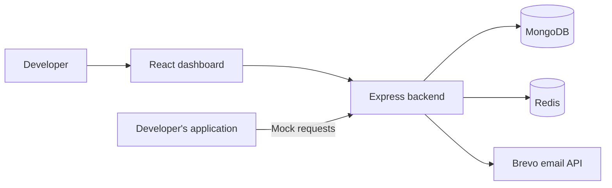
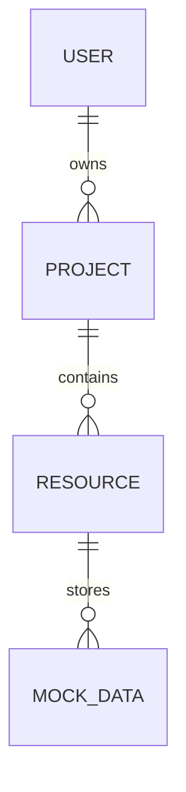

# How MockAPI Studio works

MockAPI Studio gives frontend developers a working API while their real backend is still being built. A user creates a project, defines resources such as `products` or `movies`, and adds sample records. Those resources are then available through shared REST routes.

This guide explains the current design. For local setup, start with the [README](README.md).

## The main parts

The application has a React dashboard and one Express backend. MongoDB stores the application data, Redis handles temporary cache entries and request counters, and Brevo sends verification emails.



The backend groups requests into three areas:

| Routes | Purpose | Access |
|---|---|---|
| `/api/auth` | Register, log in, and verify email | Some routes require a JWT |
| `/api/internal` | Manage projects, resources, and sample data | Verified account and ownership checks |
| `/api/mock` | Use the generated endpoints | Public, with rate limits |

Mock endpoints allow reads, writes, and deletes without login. Project prefixes identify projects; they are not passwords or API keys. These endpoints are meant for sample data.

## How the data is organized



- A **user** has a name, email, password hash, and verification state.
- A **project** belongs to a user and has a stable prefix such as `proj_a1b2c`.
- A **resource** belongs to a project and stores its name and JSON Schema.
- A **mock record** belongs to a resource and stores its payload in a flexible `data` field.

All resources share the same mock-record collection. Creating a resource does not create a new database collection or require new backend code.

MongoDB indexes keep emails and project prefixes unique, prevent duplicate resource names within a project, and help retrieve records by resource and creation time. Deleting a resource removes its records; deleting a project removes its resources and records. The application performs these deletions in sequence, without a transaction spanning all documents.

## From registration to a usable endpoint

1. The user registers. The server hashes the password, creates an account, and sends a six-digit email code.
2. The user submits the code. It expires after ten minutes and allows five incorrect attempts before a new code is needed.
3. Successful verification returns a new JWT with the verified state. Dashboard requests send that token in the Authorization header.
4. The user creates a project and a resource, providing a JSON Schema that describes the expected fields.
5. The resource becomes available immediately at a URL such as `/api/mock/proj_a1b2c/products`.
6. The user can add records manually or generate up to 500 sample records at a time.

The frontend keeps the JWT in localStorage. The server checks its signature and expiry on protected requests, then uses the user ID for ownership checks. Logout clears the browser's stored token; it does not revoke an already-issued token on the server.

## What happens during a mock request

A GET request first passes the read rate limiter. The backend then checks Redis for a cached response. On a miss, it finds the project and resource in MongoDB, loads the records, and caches the successful response.

```text
GET request -> read limit -> cache lookup
                                |
                    hit: return saved response
                    miss: query MongoDB, cache, return
```

For POST and PUT, the backend finds the resource and validates the body against its saved schema using Ajv. Invalid data returns field-level errors. Valid data is saved in MongoDB, and the project's cache is invalidated. PUT replaces the full payload.

Compiled Ajv validators are reused within each server process. Each write reads the current schema and replaces its compiled validator if the schema has changed.

## Why Redis is used

Redis handles two separate tasks.

**Response caching:** List and single-record GET results are cached for 30 seconds by default. The key includes the project, a generation ID, and a request variant such as the resource name, page, and filter.

`SET NX` creates a generation only if one is missing. A mutation replaces it with a new random ID. Future reads use the new generation, and old entries expire on their own. A slow read can still store a response under the old generation, but it cannot overwrite a response under the new one. A request already in progress may return an earlier database snapshot.

Errors and responses over 1 MiB are not cached. `X-Cache` reports `HIT`, `MISS`, or `BYPASS`. The response cache uses ordinary Redis commands, without custom Lua scripts.

**Rate limiting:** Shared Redis counters keep quotas consistent across backend instances. The limiter uses fixed windows, with separate counters per policy. Most quotas are per IP; seeding is per user. The Redis rate-limit library uses Lua internally to update counters atomically.

Redis is optional in development. Without it, reads go directly to MongoDB and limits use local memory. Production requires a Redis connection.

## Sample data

Faker generates records by walking the resource's schema. It checks enums and constants first, then composite branches, field-name hints, formats, and types. Nested objects and arrays are generated recursively with a depth limit.

This is a practical sample-data generator, not a complete JSON Schema generator. Name hints can override constraints, patterns are only approximated, and generated payloads are not checked with Ajv before insertion.

## Running and growing the service

`server/src/index.js` connects the dependencies and starts the HTTP server. `app.js` assembles middleware, routes, and error handling. Shutdown allows requests to finish and closes connections, with a ten-second deadline. `/health` checks that the process responds; it does not test database readiness.

The documented deployment uses Vercel for the dashboard, Render for the backend, MongoDB Atlas, Redis Cloud, and Brevo. See the [deployment guide](DEPLOYMENT.md) for configuration.

Multiple backend instances can share MongoDB, Redis, and JWT configuration. Areas to improve as usage grows include private mock access, cursor pagination, background seeding jobs, stronger deletion guarantees, and better monitoring. The repository does not establish a throughput or availability target.

## Things to keep in mind

- Mock APIs do not reproduce a real application's business rules. Final integration still needs the real backend.
- CORS controls browser access. JWT and ownership checks protect management operations.
- A cache read failure falls back to MongoDB. A rate-limit store failure returns 503.
- Cache invalidation can fail after a database write succeeds. Check the current data before retrying a failed write.

For implementation details, see the [backend guide](server/README.md) and [frontend guide](client/README.md).
